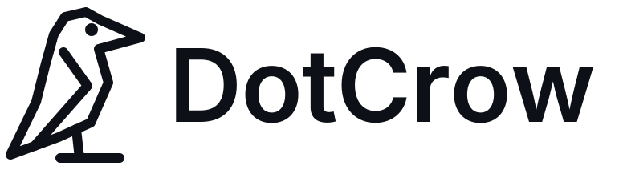

<p align="center">
  <picture>
    <source media="(prefers-color-scheme: dark)" srcset="assets/brand/dotcrow-logo-dark.svg">
    
  </picture>
</p>

<p align="center">
  <strong>Open source agents that work on your computer.</strong><br>
  You hand over the whole task. The crows plan, act, check and learn.
</p>

<p align="center"><a href="README.md">Português</a> · <a href="CONTRIBUTING.md">Contributing</a> · <a href="SECURITY.md">Security</a></p>

> [!WARNING]
> **Pre-alpha.** DotCrow does not control the computer yet, and the cryptography has not been externally audited. Do not use it with production data or keys.

## What it is

**DotCrow** ([dotcrow.si](https://dotcrow.si)) is an open source agent that runs on your own machine. Instead of asking for an answer, you delegate a complete task, and a flock of agents gets it done: one plans, one remembers how it was done before, one reviews the risks, one executes and one writes the report.

- **Several agents, each thinking differently.** Six crows with distinct reasoning and organizing styles that review each other before acting.
- **Any LLM with an API.** Claude, GPT, Gemini, OpenRouter, local models through Ollama. When one provider runs out of quota or goes down, DotCrow **fails over to the next one automatically**.
- **Invisible API keys.** Only the machine owner can add keys, and not even the owner can read them back. Keys can be listed (provider + fingerprint), deleted and replaced. There is no command that reveals a key.
- **Collective learning mode.** When one DotCrow learns a task, the *recipe* (the steps, with no personal data) can be shared with the **Revoada**, the collective memory. Opt-in, off by default.
- **Post-quantum cryptography.** Hybrid ML-KEM-768 + X25519 envelopes: an attacker has to break both. Each install has its own cryptographic identity, to be backed by a digital certificate.
- **Nothing irreversible without you.** Deleting, sending, paying or installing always asks first. Instructions found inside web pages, e-mails or files never count as orders from the owner.

## The crows

| Agent | Role | Thinks | Organizes |
|---|---|---|---|
| **Huginn** | Strategist | Top-down, goal first | As a dependency tree |
| **Muninn** | Memory | By precedent | By similarity and timeline |
| **Gralha** | Organizer | By category and inventory | As folders and tags |
| **Bico** | Executor | Step by step, verifying each one | As a checklist queue |
| **Pena** | Writer | From the reader's point of view | As a narrative |
| **Vigia** | Guardian | Adversarially | By risk level |

Huginn and Muninn are Odin's ravens in Norse mythology. *Gralha* is the Portuguese word for jay, *Bico* means beak, *Pena* means feather (and quill) and *Vigia* means lookout.

## Quick start

Requires [Rust](https://rustup.rs) 1.88+.

```bash
git clone https://github.com/napoleaomp4/dotcrow.git
cd dotcrow
cargo build --release
./target/release/dotcrow agents
./target/release/dotcrow demo failover
./target/release/dotcrow keys add anthropic
./target/release/dotcrow keys list
```

## Contributing

The main documentation is in Brazilian Portuguese, but issues and pull requests in English are welcome. Code identifiers are in English. Start with [CONTRIBUTING.md](CONTRIBUTING.md) and the issues labeled `boa-primeira-issue` (good first issue).

## License

[Apache License 2.0](LICENSE).
