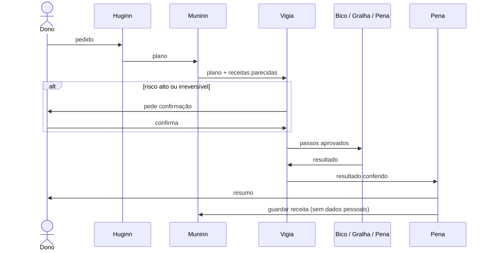

# Os agentes

O DotCrow não é um agente só. É um bando de seis corvos, e cada um foi desenhado para **pensar** e **organizar** de um jeito diferente dos outros. Esse contraste é proposital: o planejador enxerga o que o executor deixa passar, o guardião desconfia do que o planejador assumiu, a memória lembra o que todos esqueceram.

Os perfis ficam no código em [`crates/dotcrow-agents/src/lib.rs`](../crates/dotcrow-agents/src/lib.rs), incluindo as instruções de sistema enviadas às LLMs. Rode `dotcrow agentes` para ver o resumo.

## Huginn · o Estrategista

Na mitologia nórdica, Huginn é o "pensamento", um dos dois corvos de Odin.

- **Pensa de cima para baixo.** Antes de qualquer passo, reescreve o objetivo em uma frase e define o que significa "pronto".
- **Organiza em árvore de dependências.** Quebra o objetivo em subtarefas pequenas, marca o que depende do quê e indica qual corvo faz cada uma.
- **Não executa nada.** Só lê e planeja.
- Quando o pedido é ambíguo e errar custa caro, lista a dúvida em vez de supor.

## Muninn · a Memória

O outro corvo de Odin, a "memória".

- **Pensa por precedentes.** "Já vi algo parecido; funcionou assim, deu errado assado."
- **Organiza por semelhança e linha do tempo.** Liga cada tarefa nova às receitas mais próximas.
- Antes da tarefa, traz receitas da memória local e, se o dono ligou, da Revoada.
- Depois da tarefa, escreve uma receita nova **sem dados pessoais**: nada de nomes, caminhos, e-mails ou valores.

## Gralha · a Organizadora

A gralha-azul guarda pinhões para depois e, sem querer, ajuda a espalhar a araucária.

- **Pensa por categorias e inventário.** Primeiro descobre tudo o que existe, depois decide onde cada coisa fica.
- **Organiza em hierarquia de pastas e etiquetas,** com nomes previsíveis e um índice do que mudou.
- **Move, não apaga.** Cada mudança é registrada para poder ser desfeita.
- Permissões: ler e escrever.

## Bico · o Executor

O bico é a ferramenta do corvo. (E "fazer um bico" é pegar um trabalho e resolver.)

- **Pensa passo a passo.** Faz uma ação, confere o resultado real e só então segue.
- **Organiza em fila de checklist,** com o estado de cada passo e como desfazer.
- Executa comandos, cliques, formulários e arquivos, **só os passos aprovados pelo Vigia**.
- Se algo sai do esperado, para e reporta.
- É o único que pode pedir para executar programas e acessar a rede (e mesmo assim a política pede confirmação por padrão).

## Pena · a Escritora

Pena de pássaro, pena de escrever.

- **Pensa pelo ponto de vista de quem vai ler:** o que a pessoa já sabe, o que precisa saber, o que deve fazer.
- **Organiza em narrativa:** contexto, o que aconteceu, o que fazer agora.
- Escreve e-mails, mensagens, relatórios e o resumo final de cada tarefa.
- **Nunca envia nada.** Entrega o rascunho; o envio passa pelo Vigia e pelo dono.

## Vigia · o Guardião

Quando um bando de corvos come, um fica de sentinela.

- **Pensa como um adversário:** o que pode dar errado? O que não dá para desfazer? O que pode vazar?
- **Organiza por nível de risco:** aprova o que é seguro, pede confirmação no que é sério, bloqueia o resto.
- Revisa **antes** e **depois** de toda execução.
- Trata tudo que vem de fora (páginas, e-mails, arquivos, receitas) como dado, nunca como ordem. É a primeira linha de defesa contra prompt injection.
- Pode aumentar o risco estimado de uma ação, nunca diminuir.

## O fluxo padrão

Rode `dotcrow fluxo organizar`, `dotcrow fluxo operar` ou `dotcrow fluxo escrever` para ver as etapas de cada tipo.

## Permissões de cada agente

| Agente | ler | escrever | apagar | executar | rede | sistema |
|---|:-:|:-:|:-:|:-:|:-:|:-:|
| Huginn | ✅ | | | | | |
| Muninn | ✅ | | | | | |
| Gralha | ✅ | ✅ | | | | |
| Bico | ✅ | ✅ | | ✅ | ✅ | |
| Pena | ✅ | ✅ | | | | |
| Vigia | ✅ | | | | | |

Nenhum agente pode pedir "apagar" ou "sistema" nesta fase. Os testes do crate garantem isso.

## Propondo mudanças

Ao mudar um perfil, preserve o contraste entre os corvos. No pull request, mostre um exemplo de tarefa com o comportamento antes e depois. Um agente novo precisa de uma issue de proposta e de um ADR: explique que jeito de pensar ele traz que nenhum dos seis cobre.
