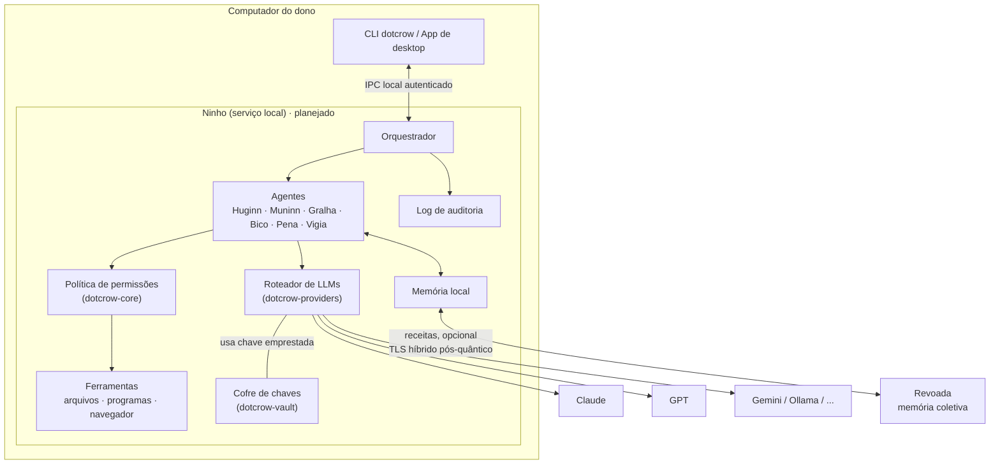

# Arquitetura

Este documento descreve como o DotCrow é montado: as peças, por onde os dados passam e onde ficam as fronteiras de confiança. As partes marcadas como *planejado* ainda não existem no código; veja o [ROADMAP](../ROADMAP.md).

## Visão geral

## As peças

| Peça | Crate | O que faz |
|---|---|---|
| Núcleo | `dotcrow-core` | Tipos comuns: `Permission`, `Risk`, `Action` e a `Policy` que decide se uma ação roda, pede confirmação ou é bloqueada. |
| Criptografia | `dotcrow-crypto` | Envelope híbrido pós-quântico para mensagens entre identidades e cifra simétrica para dados em repouso. |
| Cofre | `dotcrow-vault` | Guarda as chaves de API cifradas. Só adiciona, lista e apaga. Empresta a chave ao runtime na hora da requisição. |
| Provedores | `dotcrow-providers` | Interface `LlmProvider` comum a todas as LLMs e o `Router`, que troca de provedor sozinho quando um falha. |
| Agentes | `dotcrow-agents` | Perfis dos seis corvos (como pensam, como organizam, o que podem pedir) e o fluxo padrão de uma tarefa. |
| CLI | `dotcrow-cli` | O comando `dotcrow`. Hoje fala direto com o cofre; na fase 1 passa a falar com o Ninho. |
| Ninho | *planejado* | Serviço local que mantém o cofre aberto, roda o orquestrador, as ferramentas e o log de auditoria. |
| Revoada | *planejado* | Servidor da memória coletiva, onde ficam as receitas compartilhadas. Veja [revoada.md](revoada.md). |

As dependências entre crates só vão "para baixo": `core` e `crypto` não dependem de ninguém do projeto; `vault` depende de `crypto`; `agents` depende de `core`; a `cli` (e no futuro o Ninho) junta tudo.

## O caminho de uma tarefa

1. O dono pede algo pela CLI ou pelo app.
2. O orquestrador entrega o pedido ao **Huginn**, que devolve um plano em subtarefas.
3. O **Muninn** busca na memória local (e, se ligado, na Revoada) receitas parecidas e anexa ao plano.
4. O **Vigia** revisa cada passo e o transforma em `Action` com permissões e risco. A `Policy` decide: roda, pede confirmação ou bloqueia.
5. O executor certo (**Bico**, **Gralha** ou **Pena**) faz o trabalho pelas ferramentas, um passo de cada vez, conferindo o resultado real.
6. O **Vigia** confere se o resultado bate com o objetivo.
7. A **Pena** escreve o resumo para o dono.
8. O **Muninn** grava a receita, sem dados pessoais, na memória local.

Toda chamada de LLM passa pelo roteador. Toda ação passa pela política. Tudo vai para o log de auditoria.

## Fronteiras de confiança

| Fronteira | Regra |
|---|---|
| Dono ↔ Ninho | Só processos do próprio usuário falam com o Ninho, por canal local autenticado. Nenhuma mensagem desse canal devolve uma chave de API. |
| Agentes ↔ ferramentas | Agentes só **propõem** ações. Quem executa é o Ninho, depois da política. Cada agente tem uma lista fixa de permissões que pode pedir. |
| Conteúdo externo ↔ agentes | Tudo que vem de fora (páginas, e-mails, arquivos, respostas de LLM, receitas da Revoada) é **dado**, nunca ordem. |
| Ninho ↔ provedores de LLM | HTTPS. A chave sai do cofre só para o cabeçalho da requisição. |
| Ninho ↔ Revoada | TLS híbrido pós-quântico com certificado da instalação. Só sai o que o dono aprovou. |

Os detalhes de cada fronteira e o que **não** conseguimos proteger estão em [seguranca.md](seguranca.md).

## Decisões registradas

As decisões de arquitetura ficam em [`adr/`](adr/). Para propor uma mudança grande, copie [`adr/0000-modelo.md`](adr/0000-modelo.md).
